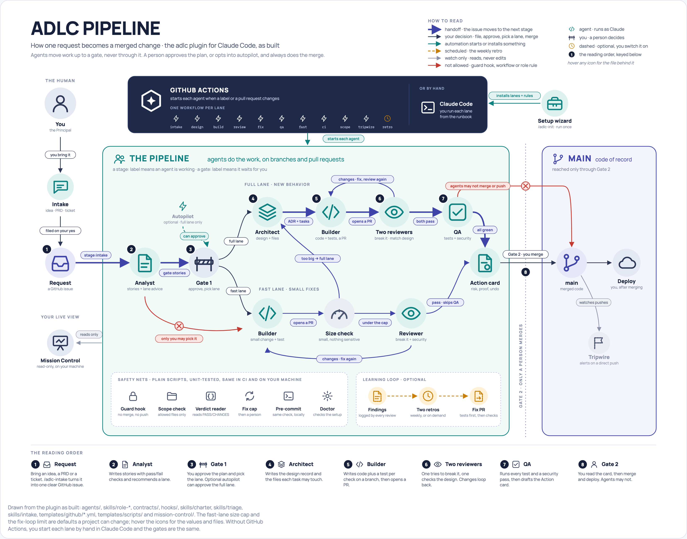

# ADLC Pipeline, Explained

Last updated: 2026-11-09

## What it is

ADLC is a Claude Code plugin that gives any code project a small team of AI agents that turn a written request into a tested, reviewed pull request. A person still makes the two decisions that matter: what gets built, and what gets merged.

Think of it as an assembly line for code changes. Each station is an AI agent with one job, and no agent ever checks its own work.

- **What goes in:** an idea, a document or a ticket, turned into one clear GitHub issue, such as "add a password reset link".
- **What comes out:** a pull request (a proposed code change) that one agent built, a separate agent reviewed and QA checked, ready for a human to merge.
- **Where it works:** a brand-new project that only has a requirements document, or an existing codebase. A setup wizard adapts it to either.
- **What agents may not do:** merge, deploy or push to the main branch. Those stay with you.
- **How you watch it:** Mission Control, a live page on your own machine.

The name stands for Agentic Software Development Life Cycle: the usual plan, design, build, test and release steps, run by agents.

## At a glance

A request normally passes two gates. At Gate 1 you approve the plan and pick the lane; optional autopilot can approve it for you, but only into the full lane. You can also put a small change straight on the fast lane yourself, which skips the Analyst and Gate 1. At Gate 2 you always merge yourself. In either lane, a review that asks for changes sends the change back to the Builder, up to 3 times before a person is called in. The numbers give the reading order; [adlc-pipeline-diagram.html](adlc-pipeline-diagram.html) is the same picture with hover details for every icon.

## The team

Five AI agents do the work, and one person, called the Principal, owns the decisions. Each agent gets only the tools its job needs: its file names them, and each automated lane grants a fixed list. A guard built into the plugin checks every shell command, and for three of the roles also where a file edit lands and which label goes on an issue. The table shows each role's rules; the list under it says what holds each one.

| Who | Their one job | What they may change | What they never do |
| --- | --- | --- | --- |
| **Product Analyst** | Turns a request into user stories with testable acceptance criteria, and recommends a lane (fast or full) | GitHub issue comments and labels only | Write code, or pick the lane itself |
| **Architect** | Writes the design decision (an ADR) and splits the work into tasks, each listing the exact files allowed. Later checks the pull request matches that design | Files under `docs/` only | Touch application code, or merge |
| **Builder** | Writes the code, plus a test for every acceptance criterion, and opens a pull request | Code, on its own feature branch | Merge, deploy, or push to main |
| **Adversarial Reviewer** | Sees only the change and tries to break it: edge cases, security holes, functions that don't exist | Nothing; it can only comment | Edit code, change labels, or merge |
| **QA & Release-Ops** | Runs the full test suite, fills test gaps, and drafts the merge-and-deploy proposal | Test folders only | Merge, deploy, or run a database migration |
| **The Principal (you)** | Approves the plan at Gate 1 and merges at Gate 2 | Everything | Nothing is done in your name without your OK |

The rule that ties the team together: whoever builds something never verifies, merges or deploys it.

The rules in the table are not all held the same way. The plugin has one file per role, its contract, that states what the role may use, and the guard reads those files:

- **The Analyst, the Architect and the Adversarial Reviewer** are held by the guard, when it is on. It limits which `gh` and `git` commands each may run. It blocks a file edit outside the role's paths: the Architect may edit under `docs/` only, the other two no file at all. And it blocks each from putting any label on an issue but its own: `gate:stories` for the Analyst, `stage:build` for the Architect, none for the reviewer.
- **What that covers, exactly.** The file rule covers Claude Code's edit tools. The label rule covers the two ways the pipeline adds a label: `gh issue edit --add-label` and the pipeline's relabel script. A file one of these roles writes through a shell command on your machine is not seen, because there they still have a shell; in the automated lanes their shell is limited to the commands the lane grants. Taking a label off is not checked.
- **The Builder and QA** have a full shell, so no tool rule can hold their files. Where the scope check is on, it holds the pull request to its scope file, plus the test folders once the issue has reached QA. QA's test-folders rule and both roles' label moves are instructions in their prompts.

## Step by step

A request goes through eight steps. Agents do five of them; the first step and the two gates are yours. GitHub labels track where it is: a `stage:` label means an agent is working, a `gate:` label means it is waiting for you. An issue is meant to carry one of these at a time: the agents and the automated lanes move it with one script, which takes the old label off as it puts the new one on. When you move a label by hand, take the old one off too, or use the same script (`.adlc/scripts/adlc-relabel.sh <issue> <label>`).

1. **You start a request.** Run `/adlc-intake` with an idea, a document or a ticket, or open a GitHub issue yourself. Either way it becomes one issue with the `stage:intake` label.
2. **The Product Analyst writes the stories.** If the request is unclear, it asks numbered questions on the issue and stops. Otherwise it writes user stories with pass/fail acceptance criteria and recommends a lane, then moves the issue to `gate:stories`.
3. **Gate 1: you approve the plan.** You read the stories and pick the lane: `stage:design` for the full pipeline, or `stage:fast` for the fast lane. With autopilot on, a full-lane plan is approved for you; the fast lane always waits for you.
4. **The Architect designs it.** It writes an ADR and a task list in which every task names the exact files that may change. In the automated lane the design is saved on its own branch, `adlc/design-<issue>`, and the Builder starts from there, so the ADR travels in the same pull request. The issue then moves to `stage:build`.
5. **The Builder writes the code.** On its own branch it implements the tasks and lists the files it may touch in a scope file, `.adlc/scope/<issue>.txt`. It adds a test for each acceptance criterion, runs the tests and opens a pull request.
6. **Two independent reviews.** The Adversarial Reviewer tries to break the change, and the Architect checks it matches the design. If either asks for changes, the Builder fixes them and both run again. A round is one review that sent the pull request back: the first three each get a Builder fix, and a fourth goes to a person instead. The automated fix loop then tags the pull request `needs:human`; when you drive by hand, the runbook has you run the same check before each return to the Builder. The count is read from the pull request's own record (a label the review lane adds, and the reviewers' verdict comments), not from its commits, so it is an estimate: a request for changes that left neither is not counted.
7. **QA proves it works.** It runs the full test suite, fills missing tests and does a security pass. If all is clean, it moves the issue to `gate:deploy` and posts a Proposed Action Card: the action, its risk, the evidence and how to undo it.
8. **Gate 2: you merge.** You read the card and the pull request, then merge and deploy yourself. Agents may not: the guard blocks a merge an agent types as a command.

The safety nets, and when each one is on:

| Safety net | What it does | When it is on |
| --- | --- | --- |
| Guard hook | Blocks merges, pushes to the main branch, force-pushes and direct writes to GitHub's API that an agent types, in every permission mode. For the Analyst, the Architect and the reviewer it also blocks a command, a file edit or a label outside the role's contract | In sessions with the plugin enabled: in the automated lanes, and on your machine in a repo set up with the pipeline. The first part applies to your own sessions too |
| Deny rules | A simpler block on the plain spellings of merge, push to main and force-push, for a session that runs without the plugin | Always; the wizard writes them |
| Scope check | Holds a change to the files its scope file declares | On your machine, for commits on a Builder branch; on pull requests once the automated lanes are installed |
| Branch protection | GitHub's own rule that a pull request needs an approving review. The pipeline's bot cannot approve its own pull request | When you turn it on; it is free on public repos |
| Main-branch tripwire | Files an alert issue, and fails its run, when a commit reaches main without a pull request or when main is force-pushed. It reports after the fact | With the automated lanes, on private repos where branch protection is not available, and only while GitHub is running the workflows |
| Setup check | `adlc-doctor.sh` checks the setup: the deny rules, the project skills, your copies of the agents, the labels, any open issue in two states and, where the automated lanes are installed, whether GitHub is still running the workflows and whether main has a merge gate | When you run it. The checks that ask GitHub need a signed-in `gh` |
| Retro | Reads past review findings and proposes tests and checks for repeat mistakes, as a pull request you approve | If you switch on the improvement loop: weekly with the automated lanes, otherwise on demand with `/adlc:retro` |

The guard reads the text of a command, so treat it as a strong guardrail, not a lock. Branch protection is the part that cannot be talked around. On pull requests the scope check runs from the main branch's copy, so a pull request cannot edit the check that judges it. With the automated lanes installed, the setup check, `adlc-doctor.sh`, tells you whether your main branch has such a gate.

The automated nets run on GitHub Actions, and they stop when Actions does. When a private repo's included Actions minutes run out, GitHub fails every workflow within seconds without running a step, the tripwire included, and the checks on a pull request just read red. The setup check looks for that pattern and reports it when you run it, and Mission Control shows a banner while its page is open. Neither sees Actions switched off for the repo, which starts no run at all.

The Retro row is one half of an improvement loop. Both halves only propose: each opens a pull request for you to review and merge like any other, or opens none when it finds nothing worth changing.

- **Retro** (`/adlc:retro`) asks what keeps going wrong in the code. It gathers the findings reviewers left on past pull requests, ranks the kinds that recur, and proposes the cheapest lasting fix for each: a regression test first, then a CI check, then a convention.
- **Cycle retro** (`/adlc:cycle-retro`) asks where a run's time and money go. It reads a run ledger (seconds, tokens and cost per agent run, taken from Mission Control's store, a telemetry collector or GitHub Actions run times, never from an agent's own report) and how long each issue spent under each label. It proposes changes to the pipeline's shape: what goes to the fast lane, what a reviewer reads, which model a step runs on. Token and cost figures exist only where telemetry is on; run on GitHub's runners it sees times and fix rounds, not tokens.
- **Follow-up chains.** A leftover that does not block a pull request becomes a follow-up issue, and when each fix draws the next one the pipeline feeds itself. Both reviews list every chain three or more issues deep and put it to you as a decision: accept the risk by labelling the chain's first issue `adlc:accepted-risk`, or open one issue that replaces the approach. QA is told to file one follow-up per pull request and none in a chain you accepted. These are instructions and a report: nothing blocks an agent that files an issue anyway.

## Two lanes

Small, low-risk changes can skip the design steps, but only with your approval and only if the real change stays small. The Analyst recommends a lane for every request; choosing it is yours.

| Step | Full lane | Fast lane |
| --- | --- | --- |
| What the Analyst writes | User stories with acceptance criteria | A short change brief with one acceptance check |
| Your first decision | Approve the stories (Gate 1) | Approve the fast lane |
| Architect design (ADR and tasks) | Yes | Skipped |
| Builder writes code and tests | Yes | Yes |
| Adversarial and security review | Yes | Yes |
| Architect design review | Yes | Skipped, as there is no design to match |
| QA agent | Yes | Skipped; CI tests still run |
| Size check | Not needed | Yes, on the real change |
| Gate 2: you merge | Yes | Yes |

A change qualifies when it touches one small area and its design is obvious: a text fix, a config value, a log line, a small bug with a clear cause. A check then looks at the change itself. It allows 5 files and 40 changed lines by default, and rejects paths that look sensitive: folders named for migrations, auth, security or infrastructure, CI and pipeline files, dependency files (`.gitmodules` among them) and secrets. A change to a submodule's pointer never qualifies: it is one line in a diff however much code it brings in. A change that fails goes back to the full lane. The check does not read the code: it goes by the size of the change, its file paths and whether an entry is a submodule or a binary file, so sensitive code under an ordinary name still depends on triage and the review.

In the automated lane the check is given the real diff, and like the scope check it also runs from the main branch's copy. The local autopilot gives it the same diff. In the runbook's by-hand recipe you run the same script on your list of files, which checks their number and paths only: there is no line total, and it cannot tell a submodule from an ordinary file.

Two rules keep the shortcut honest:

- **The fast lane is yours to start.** You apply `stage:fast`. Autopilot never does, and can only approve Gate 1 into the full lane. The Analyst is instructed only to recommend, and when the guard is on it blocks the Analyst from adding `stage:fast`, or any label but `gate:stories`.
- **Gate 2 is never skipped.** Every change, in every lane, waits for a human to merge it.

## Using it

Setup is one install and one wizard. The wizard writes files for you to review and never commits or pushes; it asks before it creates the labels or files an issue on GitHub.

1. **Install the plugin** in Claude Code: run `/plugin marketplace add juanjtov/adlc-pipeline`, then `/plugin install adlc@adlc-pipeline`.
2. **Run the wizard** inside the project you want to use it on: type `/adlc-init`.
3. **Answer a short questionnaire.** It asks for your stack, your exact test and build commands, where you deploy, your user roles, how much should run on its own and which model each agent runs on. On an existing codebase it reads the code first and pre-fills the answers.
4. **Review what it wrote.** You get the project's conventions, safety rules, charter, runbook and first ADR, your own copies of the five agents, and the small check scripts. Nothing is saved to git until you commit it.
5. **Start your first request.** It offers to file it through the intake interview: the first slice of your requirements document, or a small starter task in an existing project.

You also choose how much runs on its own:

| Mode | How each step starts | Your part |
| --- | --- | --- |
| Local recipe (start here) | You run each agent by hand, following the runbook | Each step, plus both gates |
| Local autopilot | `/adlc:autopilot <issue>` runs the runbook's steps for one issue from your own Claude Code session, one agent after another, until a reviewed pull request waits at Gate 2 or it needs you | Starting it, the lane choice when the fast lane is recommended, and Gate 2 |
| Full automation | GitHub Actions runs the Builder, the reviews and QA as labels and pull requests move. You still run the Analyst and the Architect by hand | Those two steps, plus both gates |
| Auto-start | Filing the Requirement form, or adding `adlc:auto` to an intake issue, starts the Analyst. Approving Gate 1 starts the Architect | Gate 1 and Gate 2 |
| Full autopilot | Gate 1 is approved for you, full lane only | Gate 2: review and merge |

The local autopilot is a set of instructions your session follows, not a workflow: the checks it calls are the scripts the automated lanes call, and keeping them in order is the model's job. It runs only on an issue you filed, approves Gate 1 only for a full-lane recommendation, never starts the fast lane, and never merges or deploys; when it cannot go on it labels the work `needs:human` and says why. It is the general form of a recipe one adopting repo wrote for itself and ran its pull requests through. As shipped in the plugin it has not yet been run end to end. Use it or the automated agent lanes on a repo, not both: where the lanes are installed, the label moves it makes start them too.

In the automated modes each agent step installs the plugin on GitHub's runner and runs as the plugin's own agent for its role, on the plugin's default model, with a fixed list of tools. Those agents, their skills and the guard come from that install and are not copied into your repo; the workflow files and the small check scripts are.

On your machine you run your repo's own copies of the five agents, which the wizard writes to `.claude/agents/`. Each copy loads the same role instructions from the plugin and has a `model:` line that is yours: the wizard asks for the five models, and `/adlc-model` prints them or changes one. The local recipe and the local autopilot run these copies; the automated lanes do not.

Any automated mode needs two GitHub secrets: `CLAUDE_CODE_OAUTH_TOKEN`, made with `claude setup-token` from your Claude subscription, and `ADLC_DISPATCH_TOKEN`, which lets one workflow start the next. It does not need GitHub Pro. On a private repo the workflows run on the plan's included Actions minutes, and the wizard estimates whether your CI tests fit in them before it copies the workflows; the estimate covers the tests alone, and the agent lanes use minutes too. Later, `/adlc:retro` and `/adlc:cycle-retro` run the two improvement reviews on demand.

## Ways to start a request

Every request becomes one GitHub issue labeled `stage:intake`, and `/adlc-intake` gets you there from any starting point. It asks only for what is missing, shows you the exact issue, and files it after you say yes.

| You have | What happens |
| --- | --- |
| A rough idea | Claude interviews you about the problem, the outcome, the users and what is out of scope, then drafts the issue |
| A one-page brief (PRD-lite) | Claude reads it and asks only about the gaps |
| A full requirements document (PRD) | Claude proposes slices that can ship on their own and files the first one |
| An existing GitHub issue | Claude checks it is not already in the pipeline, then sharpens it in place and labels it |
| A ticket in Notion, Linear or another tracker | Claude fetches it through that tool's connector and files a GitHub issue that links back |
| A bug | Same interview, covering what happened, what you expected and how to reproduce it |
| The Analyst's open questions | Claude answers them with you, updates the issue and tells you how to restart the Analyst |
| A request that is already clear | Skip the interview: file the Requirement form on GitHub, or label your own issue `stage:intake` |

- **Connectors:** fetching from Notion or Linear needs that connector switched on in Claude Code. Without it, you paste the ticket text.
- **Safety:** text from documents and tickets is treated as information, never as instructions.
- **Division of work:** the Analyst still writes the stories and acceptance criteria. Intake only makes sure the request is clear enough to start.
- **Restarting the Analyst:** when it stops to ask questions in auto-start mode, answer on the issue and add the `adlc:auto` label back. A comment or an edit alone does not restart it.

## Watching it run

Mission Control is a live page of the line on your own machine: one station per agent, the two gates, and each request moving between them. Open it with `/adlc-mission-control`, or try it with made-up data by running `adlc-mission-control --demo --open`.

- **It only reads.** It never changes a label, posts a comment or merges.
- **One copy serves every repo.** A menu at the top switches between the repos on this machine that are set up with the pipeline. A repo joins the menu when you start Mission Control from it, or once a Claude Code session or a pipeline agent starts in it while Mission Control is running.
- **It stays local.** GitHub is read through your own `gh` login, and what it records is kept in one file on your machine.
- **It sees agents on this machine.** Runs on GitHub's runners show their GitHub state (labels, pull request, verdicts), not their steps or tokens.
- **Token and cost figures are opt-in.** They appear in new sessions once you add the settings in `templates/settings.mission-control.json`; the command offers to do it.
- **It says when GitHub has stopped running the workflows.** While the page is open it checks about every two minutes and shows a banner when the repo's latest runs all failed within a minute and the last of them ran no step.

It needs Python 3.9 or newer, `git`, `curl` and a signed-in `gh`. There are no packages to install.

## Glossary

| Term | In plain words |
| --- | --- |
| Acceptance criterion (AC) | A pass/fail test of whether a story is done, written as Given / When / Then |
| ADR | Architecture Decision Record: a short file explaining a design choice, the options rejected and the trade-offs |
| Adversarial review | A review by an agent that sees only the change and assumes it is wrong until shown otherwise |
| Agent | An AI worker with one role, its own instructions and a fixed set of allowed tools |
| Author/verifier separation | The rule that whoever builds something never checks, merges or deploys it |
| Autopilot | Two things share the name. The `adlc:autopilot` label, in the automated lanes, approves Gate 1 for you, in the full lane only. `/adlc:autopilot <issue>` is its local counterpart: your own session runs the steps for one issue up to Gate 2 |
| Branch protection | GitHub's own rule that a pull request into the main branch needs an approving review |
| CI | Continuous integration: tests that run automatically on every pull request |
| Contract | One file per role in the plugin that states what the role may use: its tools, its commands, the files it may edit and the labels it may add. The guard reads it |
| Cycle retro | A review of where each run's time and money went, weekly or on demand, that proposes changes to the pipeline's shape |
| Diff scope | The list of files a change is allowed to touch |
| Fix loop | The Builder fixes what a review asked for and the reviewers check again. A round is one review that sent the pull request back; after 3, a person takes over |
| Follow-up chain | An issue, the follow-up issue its fix left behind, that one's follow-up, and so on |
| Gate | A checkpoint for a person. Gate 1 approves the plan; Gate 2 approves the merge |
| GitHub Actions | GitHub's built-in automation, used here to run the agents |
| Greenfield / brownfield | A brand-new project / an existing codebase |
| Guard hook | A check the plugin runs on every shell command an agent types, and on file edits by three of the roles; it blocks merges, pushes to main and force-pushes, and holds those roles to their contracts |
| Intake | Turning an idea, a document or a ticket into one clear GitHub issue the pipeline can start from |
| Issue | A GitHub ticket for one request, and the single record of where that work stands |
| Label | A tag on an issue: `stage:` means an agent is working, `gate:` means it waits for you. An issue is meant to carry one of them at a time |
| Migration | A change to the structure of a database |
| Mission Control | A read-only live page on your own machine that shows where each request is and what each agent is doing |
| PRD | Product requirements document: a written description of what to build and why |
| Principal | The person who owns the project and makes the gate decisions |
| Proposed Action Card | QA's short note before a merge: the action, its risk, the evidence and how to undo it |
| Pull request (PR) | A proposed code change, waiting for review and merge |
| Retro | A review of past review findings, weekly or on demand, that proposes tests and checks so mistakes don't repeat |
| Run ledger | A list of agent runs with the time, tokens and cost of each, built on demand from measured sources |
| Scope file | Where the Builder lists the files a change may touch (`.adlc/scope/<issue>.txt`); the scope check holds the pull request to it |
| Submodule | Another git repository embedded in this one at a fixed commit. Moving that pointer is a one-line change that can bring in any amount of code |
| Triage | Sizing a request to recommend the fast lane or the full lane |
| Tripwire | A check that raises an alert when someone pushes straight to the main branch, or force-pushes it |
| User story | A short description of what a user needs and why |
